# Flux

A macOS browser with a sidebar, folders and spaces that stay apart. Each space has its own
logins, history, passwords and extensions, so work, personal and client browsing live in one
window without leaking into each other.

Flux runs on Chrome's own framework, built from Chromium, so sites, Chrome extensions and DevTools
work as they do in Chrome. The app itself is native Swift.

Flux is at an early stage and not usable yet.

## Installing

Download `Flux.dmg` from the [latest release](https://github.com/steeven-th/flux/releases/latest)
and drag Flux to Applications. It needs macOS 15 or later on Apple silicon.

Flux isn't notarized by Apple yet, so macOS blocks it the first time:

1. Open Flux. macOS says it can't check it, and offers to move it to the Trash: click Done.
2. Open System Settings > Privacy & Security, scroll to Security, and click Open Anyway next to
   the line about Flux.
3. Confirm with your password or Touch ID. Flux opens, and macOS won't ask again.

## Building

### Requirements

- macOS 15 or later on Apple silicon
- Xcode 16 or later
- XcodeGen: `brew install xcodegen`

### Commands

    scripts/build.sh          # downloads the engine on first run, then builds a debug Flux.app
    scripts/build.sh --run    # same, then opens the app
    scripts/build.sh release  # release build
    scripts/package.sh        # release build, signed and packaged in build/Flux.dmg

When an Apple Development certificate is installed, builds are signed with it, so macOS doesn't
ask again for Flux's keychain items after each build. The app goes to
`~/Library/Developer/Xcode/DerivedData/Flux`, or to the folder in `FLUX_DERIVED_DATA` when it is set.

The first run downloads about 190 MB. Browsing data goes to
`~/Library/Application Support/Flux`.

## Documentation

Architecture decisions are recorded in [docs/decisions](docs/decisions).
[docs/engine.md](docs/engine.md) explains where the engine comes from and how to update it.
[docs/translation.md](docs/translation.md) explains how to set up page translation.
[docs/import.md](docs/import.md) tells what comes over from each browser.
[docs/extensions.md](docs/extensions.md) covers popups, side panels and their limits.
[docs/links.md](docs/links.md) explains where links from other apps open.
[docs/media.md](docs/media.md) describes the mini player and how it controls pages.
[docs/shortcuts.md](docs/shortcuts.md) lists the keyboard shortcuts and how to change them.
[docs/brand.md](docs/brand.md) describes the icon and the colors.
[docs/releasing.md](docs/releasing.md) explains how versions, release notes and the DMG are made.

## Contributing

See [CONTRIBUTING.md](CONTRIBUTING.md). Security problems go through [SECURITY.md](SECURITY.md).

## License

Flux is under the [Mozilla Public License 2.0](LICENSE), and its engine under the Apache License
2.0, as [NOTICE](NOTICE) details. The name and the logo are covered by
[TRADEMARKS.md](TRADEMARKS.md).
